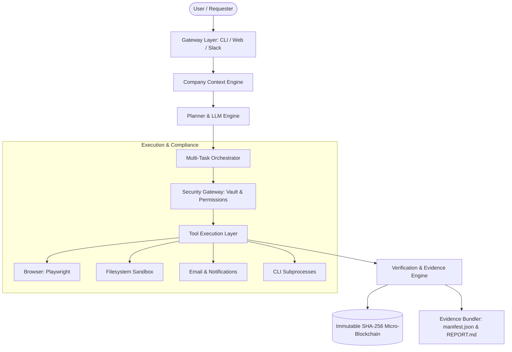
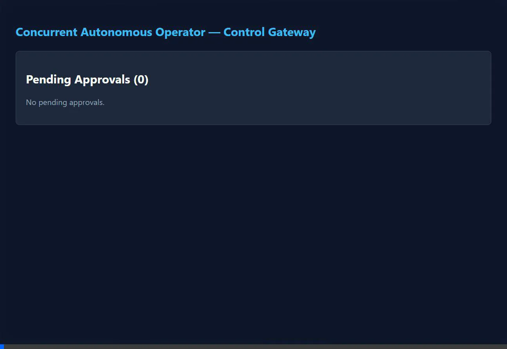
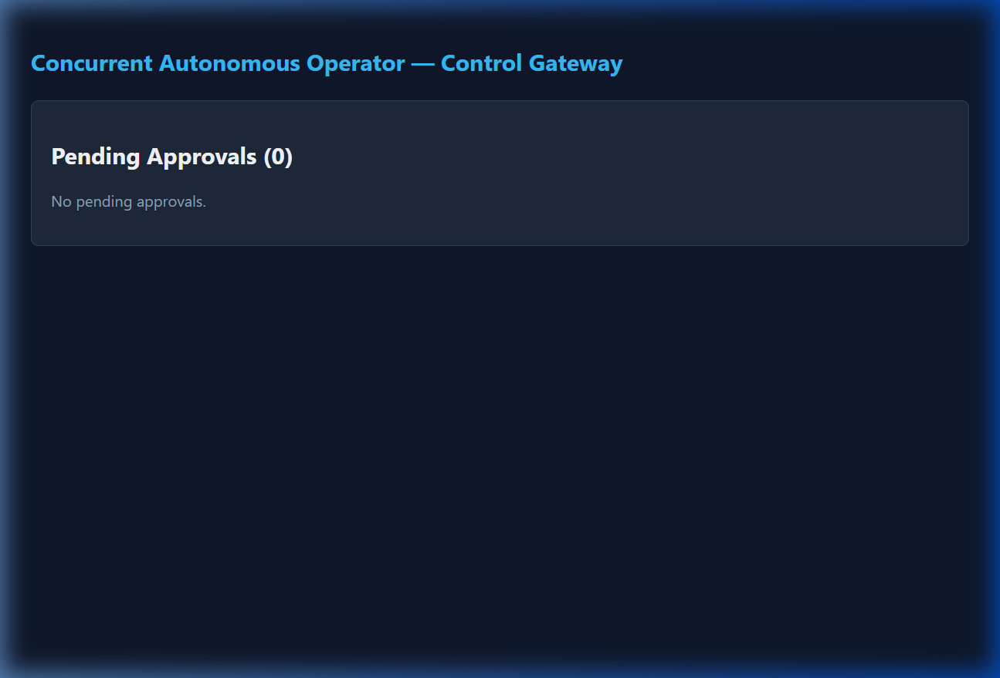

# Concurrent — Autonomous Company Operator (AI Employee)

[]()
[]()
[]()
[]()

**Concurrent** is an autonomous AI Employee designed to turn high-level company requests into completed work across browsers, desktop applications, filesystems, and internal APIs with independent verification, enterprise security, and minimal human supervision.

---

## Table of Contents

1. [Setup and Run Instructions](#1-setup-and-run-instructions)
2. [Architecture Overview](#2-architecture-overview)
3. [Important Technical & Design Decisions](#3-important-technical--design-decisions)
4. [Live Demo Walkthrough](#4-live-demo-walkthrough)
5. [Known Limitations](#5-known-limitations)
6. [Future Roadmap](#6-future-roadmap)
7. [Assumptions Made](#7-assumptions-made)
8. [Models, APIs, Frameworks & Dependencies](#8-models-apis-frameworks--dependencies)

---

## 1. Setup and Run Instructions

### Prerequisites
- **Node.js**: `v20.0.0` or higher
- **npm**: `v10.0.0` or higher
- **Docker** *(Optional, for containerized deployment)*

### Installation

```bash
# 1. Clone repository
git clone https://github.com/company/concurrent.git
cd concurrent

# 2. Install workspace dependencies
npm install

# 3. Configure environment
cp .env.example .env

# 4. Build TypeScript monorepo packages
npm run build
```

### Running the System

#### A. Interactive CLI Mode (Single Task Execution)
Execute any natural-language enterprise workflow directly in the terminal:

```bash
# Execute standard company workflow (generates plan, executes, verifies, and audits)
node apps/operator/dist/index.js -t "Generate monthly expense reimbursement report and email digest to CFO"

# Dry-run mode (simulates tool execution without writing disk files or external state)
node apps/operator/dist/index.js -t "Check if sales report file exists and notify the team on Slack" --dry-run

# Plan-only mode (inspect synthesized DAG plan without tool dispatch)
node apps/operator/dist/index.js -t "Onboard new enterprise customer #401" --plan-only
```

#### B. Daemon Mode & Live Web Control Dashboard
Run the background operator service with real-time Web Control Dashboard and Human Approval Inbox:

```bash
node apps/operator/dist/index.js --daemon
```
Open your browser to: **`http://localhost:3456`**

#### C. Running the Full Automated Test Suite
Run all unit, integration, and chaos resilience test suites:

```bash
npm run test
# or: npx vitest run
```
*Current test status: **138 tests passed across 21 test suites**.*

#### D. Production Docker Deployment

```bash
# Build production image and launch background daemon
docker-compose up -d --build

# Verify container health
curl http://localhost:3000/health
```

---

## 2. Architecture Overview

Concurrent is architected as an 8-layer modular TypeScript monorepo with clear separation of concerns:



### Monorepo Packages

| Package | Purpose & Responsibilities |
|---|---|
| **`@concurrent/core`** | Domain types (`Task`, `Plan`, `Step`, `Tool`, `Evidence`), Pino logging, custom error taxonomy (`ConcurrentError`), and central tool registry. |
| **`@concurrent/planner`** | LLM client abstraction (OpenAI, Anthropic, Ollama, Mock), `TaskClassifier` with intent/risk estimation, `PlanGenerator`, DFS dependency cycle validator, and `PlanCache`. |
| **`@concurrent/tools`** | 6 tool suites: Browser automation (Playwright Chromium), Filesystem sandbox (`PathGuard`), CLI subprocesses, Email/Slack communications, Documents (PDF/CSV/Markdown), and Desktop automation. |
| **`@concurrent/context`** | Company context engine: `KnowledgeIndexer` (chunking & cosine vector search), `ProcedureLibrary` (YAML SOP parsing), `EntityGraphManager` (org chart & pronoun resolution), and `PermissionModel`. |
| **`@concurrent/verifier`** | Independent verification: `PostConditionEngine` (DOM, HTTP, File size/hash), `EvidenceCollector`, `EvidenceBundler` (`manifest.json` + `REPORT.md`), and `ConfidenceScorer`. |
| **`@concurrent/gateway`** | Human-in-the-Loop: `ApprovalWorkflow` (approve/reject/modify/timeout), `ClarificationEngine`, `EscalationEngine`, and multi-channel dispatch (CLI + Web Dashboard at port 3456 + Slack). |
| **`@concurrent/orchestrator`** | Multi-task scheduling: `TaskQueue` (priority queue), `ResourceManager` (concurrency semaphores & rate limiters), `DependencyManager` (DAG output piping), `ErrorRecoveryManager`, and `MetricsCollector`. |
| **`@concurrent/audit`** | Enterprise security & compliance: `CredentialVault` (AES-256-GCM), `LogRedactor` (PII & token masking), `DataClassifier` (external LLM egress guard), `NetworkSecurityGuard`, and `ImmutableAuditTrail` (SHA-256 hash chaining). |
| **`apps/operator`** | Host CLI & Daemon runtime integrating all 8 packages into an executable AI Employee. |

---

## 3. Important Technical & Design Decisions

### 1. Independent Verification Over LLM Self-Assessment
- **Decision:** Never trust the agent's internal statement that a task is "done". Every task requires empirical post-condition validation via `PostConditionEngine` (verifying physical file creation, SHA-256 checksums, DOM states, HTTP codes).
- **Rationale:** LLMs suffer from completion bias and hallucinations. Hard cryptographic and system proofs guarantee enterprise reliability.

### 2. Zero-Leak Credential Vault with Auto-Redaction
- **Decision:** Secrets stored in `CredentialVault` are encrypted using AES-256-GCM. Whenever a secret is stored or decrypted, its plaintext is automatically registered with `LogRedactor`.
- **Rationale:** Even if an unhandled exception or third-party tool logs its execution parameters or stack trace, registered secrets, API keys, passwords, and private keys are masked (`[REDACTED_SECRET]`) before touching disk or stdout.

### 3. Micro-Blockchain Cryptographically Chained Audit Trail
- **Decision:** Every action, decision, permission check, and completion is appended to `ImmutableAuditTrail`, where block $N$ contains `previousHash = SHA256(Record N-1)`.
- **Rationale:** Provides tamper-evidence for enterprise compliance. Calling `audit.verifyIntegrity()` instantly detects if any log record was deleted or modified.

### 4. Deterministic Plan Caching & SOP Prioritization
- **Decision:** Routine workflows prioritize validated company Standard Operating Procedures (YAML in `config/procedures/`) and cache generated plan DAGs in `PlanCache`.
- **Rationale:** Avoids expensive LLM round-trips for routine operational tasks, eliminating hallucinations and dropping plan generation latency from ~4 seconds to < 5 milliseconds.

### 5. Multi-Channel Human-in-the-Loop Gateway
- **Decision:** Approvals and clarifications are decoupled from the CLI and dispatched through an event-driven `ChannelManager` supporting CLI prompts, a lightweight HTTP Web Dashboard, and chat webhooks simultaneously.
- **Rationale:** Enterprise employees do not sit at a developer terminal; they review and approve sensitive actions from a web dashboard or Slack channel.

---

## 4. Live Demo Walkthrough

### Web Dashboard Demo Video

The following recording demonstrates the Web Control Gateway dashboard and REST API endpoints in action:



### Dashboard Screenshot



### Executing an Enterprise Workflow

When executing:
```bash
node apps/operator/dist/index.js -t "Generate monthly expense reimbursement report and email digest to CFO"
```

The system executes the coordinated 8-phase pipeline in real time:

```text
================================================================================
  CONCURRENT v0.1.0 [DEVELOPMENT]
  Autonomous Company Operator — Enterprise Production Suite
================================================================================

[1/8 TOOLS] Initialized 13 action tools across 6 tiers (Browser, FS, CLI, Email, Notify, Docs).
[2/8 SECURITY] Initialized AES-256-GCM Vault & Immutable SHA-256 Audit Trail.
[3/8 CONTEXT] Loaded 3 knowledge chunks and 3 corporate SOP procedures.
[4/8 PLANNER] Connected to LLM provider (mock:mock-v1) with PlanCache active.
[5/8 ORCHESTRATOR] Multi-Task Queue active with ErrorRecovery & Observability collector.
[6/8 GATEWAY] Web Control Dashboard & Approval Inbox live at http://localhost:3456

--------------------------------------------------------------------------------
[TASK INTAKE] Processing: "Generate monthly expense reimbursement report and email digest to CFO"
--------------------------------------------------------------------------------

Retrieving organizational context...
  * Matched SOP: "Expense Report Submission" (confidence: 90%, steps: 4)
  * Resolved People: Sarah Chen (Accountant), Marcus Vance (CFO)
  * Target Systems: Expensify

Analyzing task intent & evaluating risk level...
  * Type: COMPOSITE | Risk: MEDIUM
  * Reasoning: Multi-system workflow: web navigation, file download, and email dispatch.
  * Synthesizing multi-step DAG execution plan...

======================================================================
Plan: Generate monthly expense reimbursement report and email digest to CFO
ID: YBioJnm9IU8o | Status: REVIEWING | Steps: 4
----------------------------------------------------------------------
  1. [browser.navigate] Navigate to expense portal
     Params: {"url":"https://expenses.internal.com"}
  2. [browser.click] Click generate report button
     Params: {"selector":"#generate-report"}
  3. [browser.download] Download generated report file
     Params: {"destPath":"evidence/downloaded_file.bin"}
  4. [email.send] Email report to finance
     Params: {"to":"finance@company.com","subject":"Q3 Expense Report"}
======================================================================

Validating plan steps against corporate security policies...
  * All steps permitted under active security policy.

Executing plan via MultiTaskOrchestrator...

================================================================================
  EXECUTION SUMMARY: SUCCESS
  Steps Completed: 4/4
  Duration: 3ms
================================================================================

Running Outcome Verification & Evidence Bundler (Phase 4)...
  * Verification: PASSED
  * Confidence Score: 100.0%
  * Evidence Bundle: evidence/YBioJnm9IU8o

[7/8 AUDIT PROOF] SHA-256 Micro-Blockchain Valid: true (4 chained records verified).
[8/8 OBSERVABILITY] Health: HEALTHY | Success Rate: 100% | Uptime: 0s

================================================================================
  Task execution lifecycle finished cleanly. Operator ready for next request.
================================================================================
```

### Generated Evidence Artifacts
Every executed task generates a cryptographic evidence bundle in `evidence/<task-id>/`:
- **[`manifest.json`](file:///r:/Work/concurrent/evidence/VRBoRVZOqZQk/manifest.json):** Structured timeline, environment metadata, tool outputs, and SHA-256 artifact checksums.
- **[`REPORT.md`](file:///r:/Work/concurrent/evidence/VRBoRVZOqZQk/REPORT.md):** Executive verification report with condition evaluation tables and audit links.

---

## 5. Known Limitations

1. **Native Desktop GUI Interaction in Headless Environments:** The `desktop.click` tool utilizes coordinate-based OS mouse events. In headless Linux/Docker environments without an active X11/Wayland display server, desktop clicks must fall back to Browser automation or CLI execution.
2. **Dynamic SPA Selector Drift:** Complex Single Page Applications (SPAs) with obfuscated or frequently changing dynamic class names can cause selector misses. While `ErrorRecoveryManager` catches selector drift, full visual self-healing requires multimodal Vision models.
3. **MFA / 2FA Gateways:** Automated tools cannot bypass hardware security keys or authenticator push notifications without pausing for human interaction via the Human Gateway.
4. **Mock LLM Default:** Out-of-the-box, the repository runs with `MockLLMClient` enabled for 100% offline, deterministic testing. Connecting to real frontier models requires providing standard API keys in `.env`.

---

## 6. Future Roadmap

If granted additional development time, the following high-impact capabilities would be built:

1. **Multimodal Vision Grounding for Desktop Apps:** Integrate Screen-VLM models to visually locate buttons and text on legacy Windows/Mac desktop applications without relying on fixed coordinates or accessibility APIs.
2. **Automated TOTP / SSO Integrations:** Support automated enterprise 2FA ingestion using time-based one-time password (TOTP) secrets stored securely in the Credential Vault.
3. **Enterprise Vector Store Backend:** Upgrade `KnowledgeIndexer` from in-memory cosine similarity to an embedded LanceDB or PostgreSQL `pgvector` store to index millions of company documents and emails.
4. **Autonomous Peer-to-Peer Agent Delegation:** Enable specialized sub-agents (e.g. Finance Operator, DevOps Operator, Support Operator) to negotiate and delegate tasks hierarchically.

---

## 7. Assumptions Made

1. **Security Sandbox:** Filesystem tools assume an isolated workspace directory (`allowedPaths`) to protect host files from unauthorized modification.
2. **Human Supervised Escalation:** Destructive actions (e.g. `database.drop`, `file.delete`, large financial transfers) are flagged as `high` or `critical` risk and assume an operator is reachable via CLI or the Web Dashboard.
3. **Node.js ESM Environment:** The codebase assumes an ESM-first TypeScript runtime utilizing Node 20+ with native `node:crypto` and `node:fs`.

---

## 8. Models, APIs, Frameworks & Dependencies

### Core Frameworks & Libraries
- **Language & Runtime:** TypeScript 5.4, Node.js 20+
- **Test Framework:** [Vitest](https://vitest.dev/) (fast ESM-native test runner)
- **Browser Automation:** [Playwright](https://playwright.dev/) (Chromium automation engine)
- **Structured Logging:** [Pino](https://github.com/pinojs/pino) (zero-overhead JSON structured logging)
- **Configuration & Procedures:** [YAML](https://github.com/eemeli/yaml) parser

### LLM Providers & Models Supported
- **OpenAI:** `gpt-4o`, `gpt-4-turbo` via REST client
- **Anthropic:** `claude-3-5-sonnet`, `claude-3-haiku` via Messages API
- **Local / On-Premise:** [Ollama](https://ollama.com/) (`llama3`, `mistral`, `qwen2.5`)
- **Deterministic Offline Testing:** `MockLLMClient` (rule-based procedural synthesizer)

### Cryptography & Security
- **Vault Encryption:** AES-256-GCM with PBKDF2/SHA-256 derived keys
- **Audit Verification:** SHA-256 micro-blockchain chaining
- **Telemetry:** Prometheus text exposition format (`/metrics`) and `/health` probes
- **Containerization:** Multi-stage Dockerfile based on Debian Bookworm Slim with Playwright system libraries
