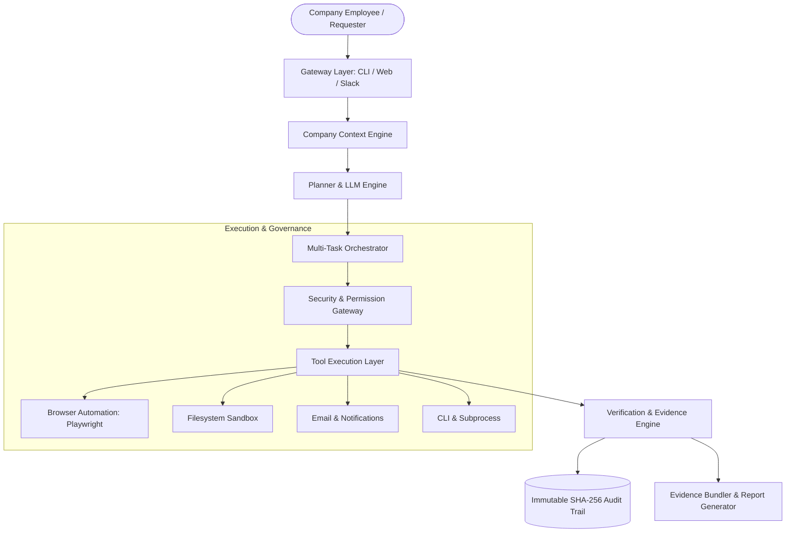

# Concurrent System Architecture

## 1. System Overview

**Concurrent** is an Autonomous Company Operator designed to execute company workflows across web browsers, desktop applications, filesystem operations, and internal APIs with minimal human supervision and guaranteed auditability.

## 2. Package Architecture

| Package | Purpose | Core Responsibilities |
|---|---|---|
| `@concurrent/core` | Core domain interfaces & taxonomies | Domain models, `ConcurrentError`, logging, tool interfaces |
| `@concurrent/planner` | Intent understanding & plan synthesis | `TaskClassifier`, `PlanGenerator`, `PlanValidator`, `PlanCache` |
| `@concurrent/tools` | Action execution capabilities | Browser (Playwright), Filesystem, CLI, Email, Document tools |
| `@concurrent/context` | Enterprise knowledge & organizational context | `KnowledgeIndexer`, `ProcedureLibrary`, `EntityGraphManager` |
| `@concurrent/verifier` | Verification & Proof of Execution | `PostConditionEngine`, `LLMVerifier`, `EvidenceCollector`, `ConfidenceScorer` |
| `@concurrent/gateway` | Human-in-the-Loop & Multi-channel | `ApprovalWorkflow`, `ClarificationEngine`, `WebDashboard`, `CLIChannel` |
| `@concurrent/orchestrator` | Execution scheduler & resilience | `TaskQueue`, `ResourceManager`, `DependencyManager`, `ErrorRecoveryManager`, `MetricsCollector` |
| `@concurrent/audit` | Enterprise security & compliance | `CredentialVault` (AES-256-GCM), `ImmutableAuditTrail`, `PermissionEnforcer`, `LogRedactor` |
| `apps/operator` | Host application | CLI runner, interactive console, daemon mode |

## 3. Data & Execution Flow

1. **Intake & Context Resolution**: The user submits a request (e.g. "Submit my expense report for $142"). The `EntityGraphManager` identifies the actor and permissions; `ProcedureLibrary` checks for company standard operating procedures (SOPs).
2. **Plan Synthesis & Caching**: `PlanCache` inspects if an identical request was solved before. If not, `TaskClassifier` assesses risk and `PlanGenerator` drafts a step-by-step DAG plan with pre/post-conditions. `PlanValidator` prevents cyclic dependencies.
3. **Multi-Task Queue & Semaphore Allocation**: The `MultiTaskOrchestrator` schedules the plan into `TaskQueue` by priority (`critical` > `high` > `normal` > `low`) while respecting concurrency limits via `ResourceManager`.
4. **Security & Permission Gate**: Before any tool executes, `PermissionEnforcer` checks roles, blocked commands, and parameter rules. Secrets are retrieved on-the-fly from AES-256-GCM `CredentialVault` and automatically registered in `LogRedactor`.
5. **Tool Execution & Self-Healing**: `PlanExecutor` dispatches the step. If a transient error occurs (503, rate-limit, DOM selector drift), `ErrorRecoveryManager` triggers exponential backoff or dynamic visual replanning.
6. **Independent Verification & Evidence**: `PostConditionEngine` evaluates DOM state, file existence, and hash proofs. `EvidenceBundler` compiles full screenshots and payload evidence.
7. **Immutable Audit Record**: `ImmutableAuditTrail` cryptographically hashes the step and links it to the prior hash via SHA-256 micro-blockchain chaining.
